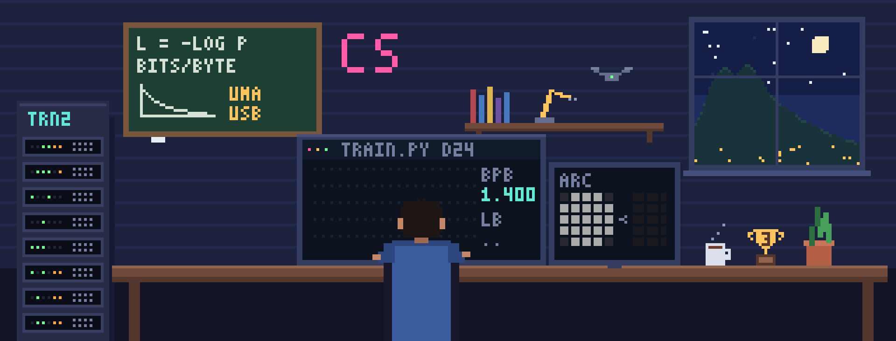

### Hi, I'm Carlos. I train language models against the clock.

I'm an ML research engineer. I pretrain models under fixed compute budgets, build agent systems that hand control back to a person when the evidence runs out, and write up what did not work as carefully as what did.

- **3rd place, AWS Trainium Frontier Phase 1.** I pretrained a language model from scratch on one Trainium2 chip in 30 minutes. Official validation score: 0.947182 bits per byte. I'm now in the 10-team final phase.
- **Founder of [Quanta Labs](https://somosquanta.com)**, which builds AI tools for K-12 schools in Latin America. I'm also a professor at Universidad Monteávila.
- **Competing in** ARC Prize 2026 and on Kaggle as [charlieesv](https://www.kaggle.com/charlieesv).

Full write-ups are at **[carsanoja.github.io](https://carsanoja.github.io)**.

---

### Research and competitions

**[Pretraining against the clock on one Trainium2 chip](https://carsanoja.github.io/projects/trainium-phase-1.html)** · AWS Trainium Frontier, Phase 1 · 3rd place
The task was to train the best language model possible in 30 minutes on one Trainium2 chip, scored on held-out bits per byte. I took the score from 1.1728 to **0.947182** over 16 official submissions, and I led the board on day one. The method: profile first, change one thing at a time, and climb a validation ladder (CPU, one core, smoke, short run) before paying for the full run. I also measured seed noise and the gap between local and official scores before trusting any difference.
`Trainium2` `Neuron SDK` `NKI kernels` `PyTorch` `FP8`

**Trainium Frontier, Phase 2** · ongoing · **5th of 10** finalists on the public board (Oct 19)
Sixteen Trainium2 chips and four hours per run, scored half on bits per byte and half on CORE. The write-up will follow the deadline.

**[Tracking dividing cells in zebrafish embryos](https://carsanoja.github.io/projects/biohub-cell-tracking.html)** · Kaggle, Biohub
3D-plus-time microscopy. Oracle experiments showed that linking was not the bottleneck, so I redirected the work to detection and cell divisions. Public leaderboard went from 0.608 to 0.946.
`PyTorch` `ILP` `tracking`

### Agents with a human in charge

**[COUNTERSIGN](https://github.com/CarSanoja/countersign)** · [write-up](https://carsanoja.github.io/projects/countersign.html)
An agent fleet that does vendor onboarding and invoice verification but cannot sign or pay. Those are capabilities no agent holds. Every risk claim must cite an evidence span, or the verdict is rejected. The signature was denied in 12 of 12 runs. A soak test drove false positives from 80.7% down to 28.1%; the README says that is still too high to deploy.
`Gemini` `Vertex AI` `Python` `agent safety`

**[GradeSync](https://carsanoja.github.io/projects/gradesync.html)** · [demo video](https://youtu.be/m3yK7J8G5Ko)
Gemini agents on Google Cloud that grade handwritten exams from upload to gradebook. In one production run, 96 of 108 exams went to the gradebook unattended and 12 were held for the teacher. My own red team ran 12 attack classes plus a clean control, and the catch rate on hostile pages rose from 83.3% to 100% with no clean page flagged.
`Google ADK` `Cloud Run` `Pub/Sub` `Firestore`

**[Repaso](https://github.com/CarSanoja/repaso)** · [write-up](https://carsanoja.github.io/projects/repaso.html)
A Telegram tutor on Strands Agents and Amazon Bedrock AgentCore that remembers which explanations worked for each learner. A dashboard shows the evidence behind every memory.
`Strands Agents` `Bedrock AgentCore` `AWS CDK`

### Open source

- [google/adk-python#6836](https://github.com/google/adk-python/issues/6836): reported, with a reproduction, that `LlmAgent` rejected `temperature=`. Fixed upstream.
- [googleapis/python-genai#2889](https://github.com/googleapis/python-genai/issues/2889): Vertex structured output silently returned empty fields typed as dicts.
- [strands-agents/harness-sdk#4207](https://github.com/strands-agents/harness-sdk/pull/4207) and [#4208](https://github.com/strands-agents/harness-sdk/pull/4208): fixes to telemetry and streaming, both with regression tests.
- [vector-db](https://github.com/CarSanoja/vector-db): LSH, HNSW and KD-tree indexes written from scratch, with a write-ahead log.
- [the-oracle](https://github.com/CarSanoja/the-oracle): lets coding assistants in different projects query each other over MCP.

### Before language models: robotics

From 2017 to 2019 I worked in ROS and Gazebo:
- [3D perception for pick and place](https://github.com/CarSanoja/RoboND-Perception-Project)
- [a home service robot](https://github.com/CarSanoja/Home-Service-Robot)
- [DQN for a robot arm](https://github.com/CarSanoja/Deep_Reinforcement_Learning_Arm_Manipulator)
- [RTAB-Map SLAM](https://github.com/CarSanoja/SLAM_project)
- [particle-filter localization](https://github.com/CarSanoja/Localization_Project)
- [a follow-me drone](https://github.com/CarSanoja/RoboND-DeepLearning-Project)

### How I work

1. State the hypothesis before the measurement.
2. Make it fail cheaply before running it expensively.
3. Know the noise floor before believing a difference.
4. Let an adversarial reviewer try to break the claim.
5. Publish the failures, with numbers.

### Tools

 

[Website](https://carsanoja.github.io) · [Kaggle](https://www.kaggle.com/charlieesv) · [ORCID](https://orcid.org/0009-0000-0339-7072)
